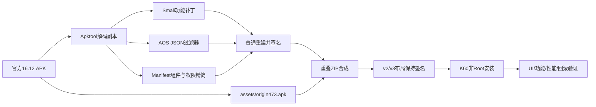

# 高德地图非 Root 精简定制技术报告

**日期：** 2026-11-15（Asia/Shanghai）  
**最终版本：** 16.12.0.2027（versionCode 161200，targetSdk 35）  
**最终 APK SHA-256：** `377FBCC407F1F569906FC4D7DF2344A5BC18CBFC2F01994E848A27D5B36B43D8`  
**官方底包 SHA-256：** `A6ABEBE509B04D9E22122CBBECB0EE86E3755EF4FA87FD1E8EC08DC3EF3196A3`

## 1. 项目目标

本项目不是简单删除资源或把按钮设为不可见，而是在非 Root 普通安装条件下，得到一份可长期使用、功能取舍明确、可验证、可回滚的高德地图定制包。

最终目标逐步收敛为：

1. 保留地图、搜索、导航、打车快捷入口、公交、酒店等固定快捷功能；
2. 保留真实消息中心、司机会话和订单提醒；
3. 保留“你好高德”唤醒助手，关闭首页手动语音按钮和 AI 对话页；
4. 修复旧版定制包“POI → 搜周边”加载失败；
5. 删除天气、猜你喜欢、推荐流、探索页和重复底部打车页；
6. 精简“我的”页，只保留足迹与必要入口；
7. 禁用桌面组件和不必要权限；
8. 比17.03底包更轻，同时比K80上的16.01旧包功能完整；
9. 交付完整 APK、差异、验证记录和回滚脚本。

## 2. 最终交付物

目录：

```text
C:\Users\Administrator\Documents\Codex\2026-11-15\new-chat\outputs\amap-v16.12-balanced-nonroot
```

文件：

```text
Amap_16.12.0.2027_Balanced_NonRoot_Optimized.apk
Amap_16.12.0.2027_Balanced_NonRoot_Optimized.diff
VERIFICATION.txt
ROLLBACK.sh
TECHNICAL_REPORT.md
```

K60当前安装的 `base.apk` 哈希与交付APK一致。

## 3. 版本选择

### 3.1 对比对象

| 包体 | 状态 | 特点 |
|---|---|---|
| K80定制包 16.01.1.2018 | 长期使用样本 | 约190.47MB，网络响应过滤覆盖广，但附近功能发生加载失败 |
| K60初期定制包 17.03.0.2008 | 新版尝试 | 221.61MB，新功能更多，但内存、CPU和首页复杂度较高 |
| 16.12.0.2027官方完整包 | 最终底包 | 159.10MB、arm64完整原生库、targetSdk 35，处在附近问题修复版本之后 |
| 16.21 / 16.25下载候选 | 未采用 | 下载到的是Play基础分包，`lib/`为0，不能作为单APK独立运行 |

### 3.2 为什么选16.12

16.12兼顾了三个条件：

- 比16.01更新，服务器接口和Android适配更完整；
- 比17.03轻，代码、资源和运行内存更低；
- 是完整arm64单包，而不是缺少动态库的Play base split。

因此它更适合继续做非 Root 通用定制。

## 4. 总体架构



核心思想是：**原始底包保持不变，所有修改发生在解码副本；运行数据尽量在进入AJX/UI之前过滤；最终用内嵌官方包和重叠ZIP结构解决非Root安装及体积问题。**

## 5. 非 Root 签名兼容与打包

### 5.1 应用入口

将：

```smali
.super Landroid/app/Application;
```

改为：

```smali
.super Lbin/mt/signature/KillerApplication473;
```

并加入：

```text
bin/mt/signature/*
lib/arm64-v8a/libSignatureKiller473.so
assets/origin473.apk
```

### 5.2 为什么需要内嵌官方包

高德内部存在签名/包完整性依赖。签名兼容层需要官方包中的签名信息和原始条目。将官方包放入 `assets/origin473.apk` 后，外层改包可用测试证书安装，同时内部查询仍可获得兼容结果。

### 5.3 重叠ZIP

普通重建会同时包含新APK和完整官方APK，体积很大。重叠ZIP让未修改条目物理复用官方包中的字节，只为修改条目写新数据。

最终结果：

```text
官方完整包：159,104,271 bytes
普通定制逻辑 + 内嵌官方后的优化包：195,358,950 bytes
```

### 5.4 关键错误与修正

曾出现：

```text
Targeting R+ requires resources.arsc to be stored uncompressed and aligned on a 4-byte boundary
```

根因是普通重建包中的 `resources.arsc` 未对齐。最终采用自定义布局合成和签名流程，对所有未压缩条目按要求对齐。

另一个问题是只写入了官方APK字节，却没有中央目录的 `assets/origin473.apk` 条目。解决方法是在普通重建前就加入占位/真实资产，再进行重叠合成。

## 6. 网络响应过滤

### 6.1 统一入口

在：

```text
com/amap/bundle/aosservice/response/AosResponse.getResponseBodyData()
```

取得响应字节后、返回业务层前调用：

```text
GaodeMapPatcher.patchAosResponseBody(byte[], response)
```

这使过滤发生在：

```text
服务器响应 → 本地过滤 → AJX/原生业务 → UI
```

而不是：

```text
创建全部UI → 再把UI隐藏
```

### 6.2 必须放行的接口

为了避免误伤，明确保留：

```text
/v1/ai_rec/                             语音唤醒回复
/ws/aos/main/page/product/list          我的页功能卡
/shield/dsp/profile/index/nodefaasv3    我的页资料与入口
/c3frontend/af-nearby/nearby            附近内容
/shield/search/nearbyrec_smart          周边搜索
/ws/message/notice/list                 消息红点/通知
/ws/msgbox/pull_mp                      消息相关
```

### 6.3 周边加载失败修复

K80的旧过滤规则会拒绝附近推荐接口，导致点击“搜周边”后显示加载失败。

最终方案不是关闭附近过滤器，而是：

- 放行附近页面和附近推荐接口；
- 保留 `scene/recommend` 中的 `toolsRecommend`；
- 继续删除与附近核心结果无关的推荐结构。

实测：

```text
NEARBY_LOAD_FAILURE=0
NEARBY_RETRY=0
NEARBY_FOOD=2
NEARBY_HOTEL=1
NEARBY_1KM=1
```

## 7. 首页精简

### 7.1 底部Tab

16.12中对应关系：

| 类 | 功能 | 最终状态 |
|---|---|---|
| `fo2` | 首页 | 保留 |
| `co2` | 探索/附近 | 关闭 |
| `ao2` | 消息/AI对话 | 保留真实消息，禁用AI场景 |
| `eo2` | 底部打车 | 关闭 |
| `bo2` | 我的 | 保留 |

`AISceneService.isSceneEnable()` 对 `ai_conversation`、`ai_tab_conversation` 返回false，其他AI场景仍交给原管理器，达到“真实消息页保留、语音唤醒保留、AI对话页关闭”。

### 7.2 手动语音按钮

`SearchBarV2.onAttachedToWindow()` 将手动语音容器设为 `GONE`，`onClick()` 对该容器直接返回。扫码按钮仍保留。

### 7.3 首页推荐数据

新增 `CleanHomeFilter`：

- 主页面AIQS和推广响应返回空数据；
- `scene/recommend` 只保留 `toolsRecommend`；
- 固定快捷入口继续正常显示；
- 其他场景推荐数据不进入首页。

### 7.4 天气请求彻底停止

以下方法在请求之前返回：

```text
mk6.doBizLogic()
lk6.run()
WeatherRequestHolder.sendInfo(...)
WeatherRequestHolder.sendMoji(...)
```

这同时停止：

- 天气专用单次定位；
- `/ws/valueadded/weather/v2`；
- `/ws/render/weatherservice/historyweather`。

AJX仍会绘制本地天气空壳，因此保留188dp裁剪作为显示层兜底。该边界保留两排快捷入口和回家/单位/常去地点/编辑，只裁掉天气空壳与后续内容。

结果：

```text
天气=0
猜你喜欢=0
推荐=0
回家=1
去单位=1
常去地点=1
编辑=1
WEATHER_LOG_MATCHES=0
```

## 8. “我的”页精简

### 8.1 顶层卡片

只保留：

```text
MineNewFootprintCard
MineNewBEntranceCard
```

删除的主要卡片：

```text
MineNewVirtualAssetCard
MineNewDoubleRowCard
MineMemberRecommendTaskCard
MineGoodsDisplayCard
PopularActivitiesCard
```

同时兼容17.03中带 `V2/V3/V5` 后缀的命名。

### 8.2 内部入口

从 `MineNewBEntranceCard.entranceList` 删除：

```text
店铺入驻
地图共建
家人地图
地图小程序
```

保留订单、收藏、待评价、钱包卡券、高德运动、工具箱等用户仍可能使用的入口。

### 8.3 数据量变化

```text
原始卡片：7
最终卡片：2
原始入口：10
最终入口：6
原始缓存JSON：63,377 bytes
最终缓存JSON：2,349 bytes
```

缓存JSON下降约96.3%，同时避免营销卡片的布局、图片请求、曝光统计和二级资源加载。

## 9. 消息页处理

### 9.1 真实消息页

保留真实消息Tab，验证：

```text
订单提醒=1
打车会话=1
语音输入面板=0
```

### 9.2 底层营销过滤

`CleanMessageFilter` 仅在响应包含 `dataList` 且命中关键词时解析JSON，删除新的营销会话更新，例如：

```text
超划算
借钱
活动
打卡消息
地点评论
真探
公共交通动态
高德运动
足迹动态
```

订单和打车标题不匹配，继续保留。

### 9.3 为什么最终仍显示旧营销会话

旧会话来自AJX/账户本地状态，不完全由当前AOS响应生成。网络层过滤只能阻止新更新，不能可靠删除旧缓存。

曾尝试渲染层隐藏，但会保留空白位置。根据用户最终选择：

- 会话行保持显示，保证列表连续；
- 底层继续过滤新营销更新；
- 不在最终包中保留渲染层隐藏器。

这是功能完整性和界面观感之间的明确取舍。

## 10. 桌面组件与权限

Manifest修改：

- 19个 `:widgetProvider` 组件设为 `enabled=false`；
- 移除 `com.google.android.gms.permission.AD_ID`；
- 移除 `android.permission.REQUEST_INSTALL_PACKAGES`；
- 保留厂商推送，以免影响司机消息和订单提醒；
- 保留录音、音频和蓝牙权限供唤醒助手使用。

运行进程最终只有：

```text
com.autonavi.minimap
com.autonavi.minimap:locationservice
```

没有 `:widgetProvider` 进程。

## 11. 性能结果

### 11.1 最终16.12

```text
APK：195,358,950 bytes
冷启动：341,335,363,328,343ms
平均：342.0ms
PSS：879,781KB
RSS：1,203,376KB
进程：2
```

### 11.2 对比早期17.03

```text
APK：221,612,055 bytes
冷启动平均：343.2ms
PSS：1,192,887KB
RSS：1,506,756KB
进程：2
```

结果：

- APK小11.85%；
- 冷启动基本持平；
- PSS约少26.2%；
- RSS约少20.1%；
- 天气请求和大量首页/我的营销数据不再运行。

## 12. 主要失败与经验

### 12.1 只隐藏UI不等于优化

天气卡设为不可见后，天气定位和请求仍可能发生。最终必须同时处理请求入口、响应数据和本地AJX空壳。

### 12.2 父容器层级不能猜

隐藏整个 `NewQuickServiceView` 曾导致搜索栏残留、底部Tab消失；隐藏 `home_scroll_view` 又造成大片空白。必须通过UIAutomator层级确认真实父子关系。

### 12.3 固定高度有状态差异

150dp能稳定隐藏天气，但会裁掉回家/单位；188dp在当前16.12布局中保留回家/单位，并隐藏天气壳。高度应以实际边界测量，而不是经验估算。

### 12.4 消息缓存不是普通XML/SQLite

营销会话由AJX/账户状态恢复，删除网络响应或常规数据库并不能彻底移除。渲染隐藏虽能消失，但会产生空位，因此最终按用户选择保留旧行，只过滤新数据。

### 12.5 中间版本“小包”可能只是分包

16.21/16.25候选体积小，但没有原生库，不能直接作为通用单APK。版本选择必须看ZIP结构，不能只看下载页大小。

## 13. 最终验证

通过：

- v1/v2/v3签名；
- 内嵌官方APK哈希；
- 非Root普通安装；
- K60设备 `base.apk` 哈希一致；
- 首页固定功能；
- 天气/推荐隐藏；
- 回家/单位/常去地点恢复；
- 真实消息页；
- “我的”页精简；
- 周边搜索；
- 唤醒录音管线；
- 五轮冷启动；
- 无FATAL、ANR、VerifyError、NoClassDefFoundError或UnsatisfiedLinkError；
- 回滚副本测试。

手机未因本轮普通APK/UI修改而重启。

## 14. 已知限制

1. 16.12无法展示一种新格式消息，页面会提示升级；
2. 旧营销会话仍显示，这是用户为避免空白行选择的结果；
3. 唤醒助手持续监听仍有电量成本；
4. 代码和资源没有物理删除，安装包体积不会随每个UI过滤等比例下降；
5. 未来服务器更改JSON字段、端点或卡片命名时，需要重新抓取真实首包并更新过滤表。

## 15. 后续建议

优先级从高到低：

1. 对新高德版本先运行APK结构盘点，确认完整包；
2. 复用AOS过滤框架，但重新发现类名和数据键；
3. 用真实首包更新“我的”、首页和消息过滤表；
4. 始终先保留附近、打车、订单、消息和唤醒端点；
5. 只在请求与数据处理完成后使用最小显示层兜底；
6. 每次最终交付都执行安装哈希、功能矩阵、性能和回滚验证。

## 16. 对应 Skill

已创建：

```text
C:\Users\Administrator\.codex\skills\amap-apk-customization
```

后续处理高德APK时，可直接调用：

```text
$amap-apk-customization
```

Skill内包含实现手册、已知陷阱、验证发布流程和可复用APK/JSON分析脚本。
